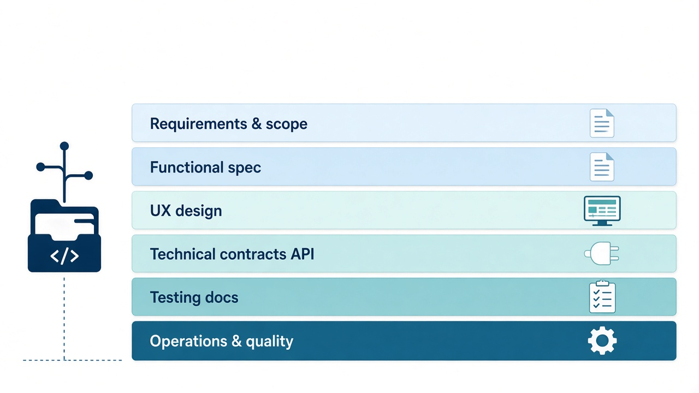
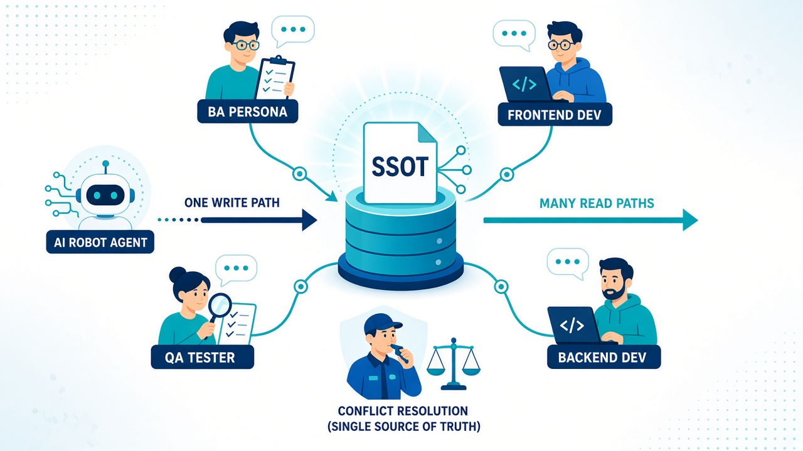
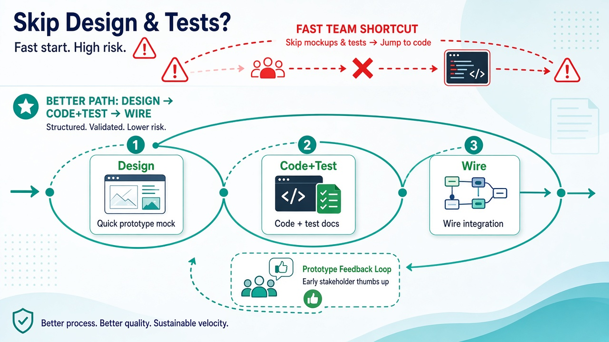
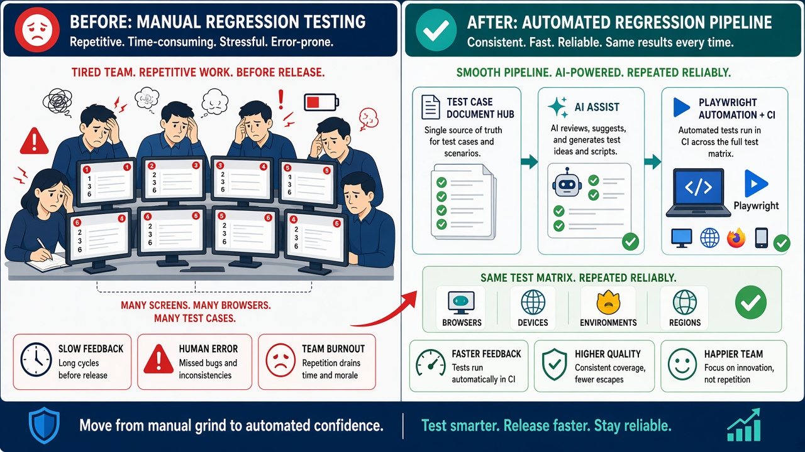

# CoSquad 🚀

> **AI-Powered & Deterministic SDLC Automation Toolkit**  
> Giữ vững kỷ luật SDLC và tính toàn vẹn của Single Source of Truth (SSOT) cho các dự án phần mềm tốc độ cao mà không phải chịu chi phí viết tài liệu thủ công đắt đỏ.

---

## 📦 Cài đặt nhanh (Quick Start)

Cài đặt trực tiếp công cụ vào môi trường của bạn thông qua script phát hành tự động bằng Git Personal Access Token (PAT):

```bash
export COSQUAD_GITHUB_TOKEN=github_pat_XXXXX
export COSQUAD_REF=latest

curl -fsSL \
  https://raw.githubusercontent.com/ShanYuCoder/Doc-CoSquad/main/scripts/install-from-release.sh \
  | bash -s -- "$COSQUAD_GITHUB_TOKEN"
```

---

## 🔄 Quy trình chuẩn hóa (Workflow Pipeline)

AI phục vụ con người — AI không thay thế con người:

- **AI chịu trách nhiệm về ***Lượng***:**
  - AI Agent chịu trách nhiệm đảm bảo **đủ lượng** thông tin theo chuẩn cấu trúc.
  - Tự động audit kiểm tra xem thông tin đã đủ chưa; nếu chưa, AI sẽ chủ động đề xuất các phương án lựa chọn *(Ví dụ: Kiểm tra trang đã có thông tin tiêu đề, breadcrumb chưa? Các phần tử form element đã có đủ type, validate, trạng thái lỗi chưa?... Nếu chưa đủ thì đề xuất cho người dùng lựa chọn hoặc bổ sung)*.
- **Con người chịu trách nhiệm về ***Chất***:**
  - Con người chịu trách nhiệm về **độ chính xác và tính chỉn chu** của thông tin cung cấp cho AI.
  - Chịu trách nhiệm trực tiếp cho các **lựa chọn và quyết định** của mình khi AI đưa ra đề xuất.
  - Chất lượng của sản phẩm có chính xác và liên kết chặt chẽ hay không hoàn toàn do thông tin con người cung cấp cho AI và do các lựa chọn quyết định của con người.

```text
Requirement thô (bullet / ảnh / legacy code)
  │
  ▼
AI chuẩn hóa bundle + IR + render MD
  │
  ▼
Khử trùng lặp qua Anti-Copy-Paste Guard (Common Catalog CMN-*)
  │
  ▼
Prototype + review BA/QA/Dev
  │
  ▼
Codegen E2E / BE / wire + safety net
```



---

## 🎯 Mục tiêu: Mô hình Agile T-Shaped

```text
                                 COSQUAD CO-PILOT PLATFORM
                                 (Mô hình Agile T-Shaped)
                                             │
             ┌───────────────────────────────┴───────────────────────────────┐
             ▼                                                               ▼
   ĐỐI VỚI NON-TECH (BA / QA / PO)                                ĐỐI VỚI DÂN TECH (DEV / CODER)
   ───────────────────────────────                                ──────────────────────────────
1. TRUY VẾT & ĐẶC TẢ:                                          1. TRỢ LÝ CODEGEN ĐẮC LỰC:
   Lặn sâu 5 tầng code, bóc tách                                  Sinh scaffolding, boilerplate, mock API,
   nghiệp vụ sạch sẽ, dẫn chứng số dòng.                          sync IR, format Swagger chuẩn chỉ.

2. LÀM MỚI & THAY ĐỔI (CR/New Feature):                        2. PHẢN BIỆN NGHIỆP VỤ (VAI TRÒ BA):
   Không chỉ đặc tả — CoSquad hỗ trợ                              - Chủ động hỏi vặn edge cases, concurrency,
   sinh mã và đấu nối từ spec đã duyệt                            anti-goals để hoàn thiện logic trước khi code.
   để ra sản phẩm chạy được!                                      - Chuyển hóa lỗi kỹ thuật khô khan thành
                                                                  ngôn ngữ product/user thân thiện, gần gũi.
3. RA QUYẾT ĐỊNH DỄ DÀNG:
   Đề xuất (Recommended) + Alternative                            3. BẢO ĐẢM CHẤT LƯỢNG (VAI TRÒ QA):
   + Tech Debt để tự tin bấm duyệt 80%                            - Tự động bổ sung toàn bộ case Unhappy,
   công việc mà không phụ thuộc Dev.                              biên đặc biệt, rò rỉ dữ liệu, bão lỗi...
                                                                  - Tự động sinh mã E2E Playwright từ spec.
```

- **Đối với Non-Tech (BA / QA / PO):**
  - **Truy vết & Đặc tả:** Khám phá mã nguồn 5 tầng, bóc tách nghiệp vụ chính xác với dẫn chứng số dòng cụ thể.
  - **Tự động hóa tính năng mới:** Khi làm CR hay tính năng mới, CoSquad hỗ trợ sinh mã nguồn và đấu nối trọn gói (`/api`, `/prototype`, `/wire`) trực tiếp từ spec đã duyệt để ra sản phẩm chạy được.
  - **Tự chủ ra quyết định:** Nhận đề xuất đa chiều `(Recommended) + Alternative + Tech Debt` để tự tin phê duyệt 80% công việc mà không bị nghẽn phụ thuộc vào Dev.

- **Đối với Developer (Coder / Tech Lead):**
  - **Giải phóng khỏi việc tẻ nhạt:** Tự động hóa hoàn toàn scaffolding, boilerplate, mock API, sync IR và format Swagger chuẩn chỉ, giúp Dev tập trung 100% vào core business logic và kiến trúc.
  - **Phản biện nghiệp vụ (như một BA chuyên sâu):** Chủ động đặt câu hỏi làm rõ các trường hợp biên (edge cases), xử lý đồng thời (concurrency), anti-goals; đồng thời chuyển hóa lỗi kỹ thuật khô khan (*500 Internal Error*, *Unique constraint failed*) thành thông điệp thân thiện với người dùng.
  - **Bảo đảm chất lượng (như một QA kỹ tính):** Chủ động rà soát và bổ sung toàn diện các kịch bản Unhappy, bão lỗi (error storming), chặn đứng rủi ro từ điểm mù tư duy trước khi release, và tự động sinh mã kiểm thử E2E Playwright.



---

## ⚡ 6 Thế mạnh Kiến trúc & Vận hành

| # | Slogan Định Hướng | Ý Nghĩa Cốt Lõi |
| :-: | :--- | :--- |
| **1** | **Mở rộng năng lực T-Shaped** | San phẳng rào cản chuyên môn: Dev hiểu sâu nghiệp vụ, BA tự làm prototype, QA chủ động sinh automation test. |
| **2** | **Early Feedback Prototype** | Chốt giao diện, luồng thao tác và triệt tiêu 80% nguy cơ rework từ bản prototype tương tác thực tế sớm. |
| **3** | **Khép vòng Automation Test** | Tự động sinh mã E2E Playwright (`*.spec.ts`) từ ma trận testcase, giải phóng áp lực kiểm thử hồi quy. |
| **4** | **Anti-Copy-Paste Guard** | Quét sạch mã rác, cưỡng chế chuẩn hóa dùng chung qua Common Catalog (`CMN-UI-*`, `CMN-API-*`, `CMN-DTO-*`). |
| **5** | **Máy lo "Lượng", Người chốt "Chất"** | `coSquad audit` quét đủ cấu trúc/schema — Con người (BA/Dev/QA) phản biện (*grill*) và bấm quyết định SSOT cuối cùng. |
| **6** | **Khung chuẩn - Linh hoạt rủi ro** | Dự án nhỏ tối ưu cắt giảm bước; dự án trọng yếu (Hotspots) tuân thủ nghiêm ngặt từ spec đến E2E test. |



---

## 🔄 End-to-End Workflow với Agent AI

Sau khi setup, mở workspace trên Agent AI (Cursor, Antigravity, Claude Code,...) để vận hành theo sơ đồ luồng:

```text
                        coSquad setup
                      (Dựng workspace)
                              │
                            /init
                    (Map surfaces & repo)
                              │
                         Loại dự án?
                              │
         ┌────────────────────┼────────────────────┐
         ▼                    ▼                    ▼
     (Maintain)           (Rebase)           (Greenfield)
         │                    │                    │
      /trace               /legacy               /spec
(Khảo cổ code)       (Trích xuất legacy)   (Đặc tả tính năng)
         │                    │                    │
         └────────────────────┼────────────────────┘
                              │
                    /prototype & /api-spec
                              │
                    /testcase & codegen
                              │
                            /wire
                    (Tích hợp & đóng gói)
```

### Bảng chi tiết các bước thực thi

| Bước | Lệnh / Skill | Mô tả cốt lõi |
| :--- | :--- | :--- |
| **1. Setup** | `coSquad setup [name]` | Khởi tạo skeleton, cấu hình MCP và harness cho AI agent. |
| **2. Discover** | `/init` | Agent quét workspace, map surfaces, bóc tách Common Catalog (`CMN-*`) và kích hoạt Anti-Copy-Paste Guard. |
| **2.1. Lập Plan** | `/help-plan` | Phân tích `inition-inventory.md`, config và hiện trạng để lên Action Plan chi tiết từng bước, rà soát toàn diện User Flow liên đới. |
| **2.2. Huấn luyện Template** | `build-template-code` | Tự động phân tích Golden Sample (module mẫu sạch nhất) để sinh custom codegen templates theo đúng kiến trúc dự án. |
| **3. Khảo cổ** | `/trace` *(Maintain)*<br>`/legacy` *(Rebase)* | • `/trace`: Quét mã nguồn trong `source-code` để đối chiếu & sinh spec.<br>• `/legacy`: Đọc Read-Only từ `source-legacy`, trích xuất spec/template sang `source-code`. |
| **4. Đặc tả** | `/spec`, `/grill` | Viết Leaf Bundle spec cho từng màn hình/tính năng, phản biện logic nghiệp vụ. |
| **5. Thiết kế & API** | `/prototype`, `/api-spec` | Sinh HTML prototype tương tác & định nghĩa API contract (`01-backend-spec.yaml`). |
| **6. Kiểm thử** | `/testcase`, `testcase:gen` | Xây dựng ma trận `TC-*.yaml` và sinh code kiểm thử tự động E2E Playwright. |
| **7. Tích hợp** | `/wire` | Đấu nối FE với API thật, chạy audit đối chiếu spec ↔ code và hoàn tất. |



---

## 📚 Tài liệu tham khảo

- 📖 **[Tài liệu dự án (GitHub)](https://github.com/ShanYuCoder/Doc-CoSquad)** — Đọc tài liệu và tra cứu trực tiếp trên GitHub repository.
- ⚙️ **Thư mục [workflows/](https://github.com/ShanYuCoder/Doc-CoSquad/tree/main/workflows/)** — Chi tiết các phase phát triển, quy trình vận hành và bộ protocol chuẩn (`SSOT_AGENT_PROTOCOL.md`, trace, legacy, help-plan, grill-bqa, testcase).
