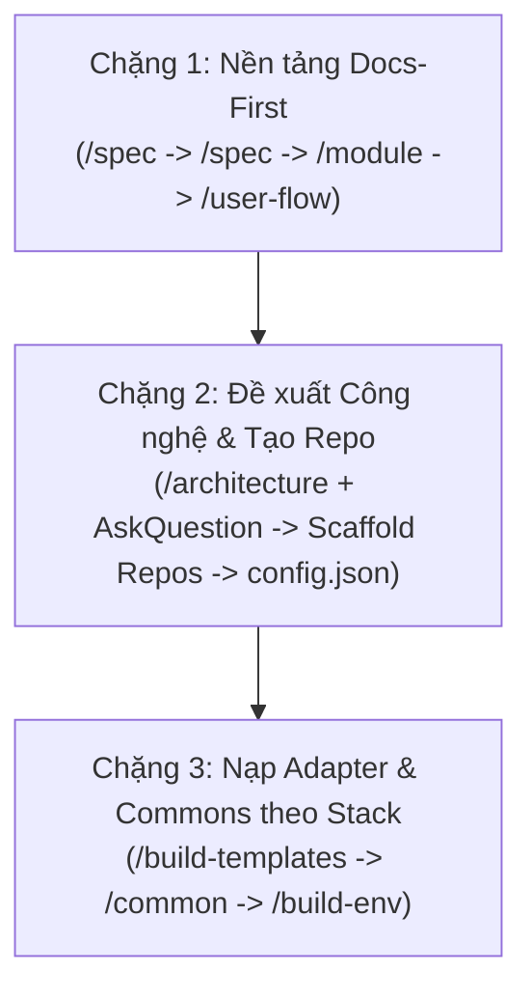

> [!CRITICAL] MANDATORY PRE-FLIGHT
> **[MANDATORY]** Re-read this entire `SKILL.md` via file-read tool. STRICTLY FORBIDDEN to rely on memory. All harness skills MUST be authored in English only.

# /init — Repository Discovery, Deep Architecture Scan & Smart Common Reconciliation

> **[LANGUAGE RULE]** The Agent MUST read `.coSquad/config.json` to determine the output language.
> - **Content/Prose:** MUST be written in the language specified by `docsLanguage.docsProseLocale` (e.g., `vi` for Vietnamese). Do NOT output prose in English unless `docsProseLocale` is `en`.
> - **Structure/Headings/Keys:** MUST use the language specified by `docsLanguage.structureLocale` (typically `en` for global standard keys/labels).

**Audit Interlock:** Run `coSquad audit legacy <target-id>`. Consume JSON gap report to verify mapping or prompt member if index is missing.

**Handoff SSOT spec:** After init, member drills [spec-ssot-prep.md](../../../docs/workflows/spec-ssot-prep.md) — Phase 0 → `/legacy /spec` per `W-*` (do not jump straight to a bundle whose ID is not in the inventory).

**Inventory template:** Section layout + **user-flow placement tiers** (cross-surface → `architecture/03-user-flows/`).

---

## 1. Phát hiện Ban đầu & Chế độ Thực thi

- **[MANDATORY]** Khi bắt đầu `/init`, Agent **BẮT BUỘC** chạy `coSquad repo-maps auto-scan --json` trong terminal để phát hiện các repository nội bộ trong workspace, đồng thời tiếp nhận đường dẫn repo bên ngoài nếu user cung cấp trong chat.
- **[TỰ ĐỘNG NHẬN DIỆN ZERO-REPO]** Nếu `coSquad repo-maps auto-scan` phát hiện **0 repository** và member không cung cấp đường dẫn ngoài, workspace được xác định là **Greenfield (Dự án Mới Toàn Bộ / Chưa Có Source Code)**. Agent **TUYỆT ĐỐI KHÔNG ĐƯỢC** cố quét code, bịa repo ảo hay dẫn dắt lung tung.
- **[MANDATORY]** Agent **BẮT BUỘC** hiển thị câu hỏi qua modal `AskQuestion` để Member chọn chế độ:
  - **Lựa chọn 1 (Đề xuất cho code sẵn có):** `(Recommended) Full Deep Init (Map Repos vào Surfaces trong config.json + Quét kiến trúc sâu & Commons cho Frontend/Backend)`
  - **Lựa chọn 2 (Cho dự án mới / Chưa có code):** `Greenfield Staged Bootstrapping (Định hình nghiệp vụ trên Docs -> Đề xuất công nghệ & Tạo Repo -> Nạp Adapter & Commons)`

---

## 2. Cơ Chế Khởi Tạo Từng Phần Cho Dự Án Mới (Greenfield Staged Progressive Bootstrapping)

Khi bắt đầu một dự án mới hoàn toàn chưa có mã nguồn (hoặc khi Member chọn Chế độ 2), Agent **BẮT BUỘC thực thi quy trình khởi tạo từng phần 3 Chặng**, tận dụng triệt để các skill CoSquad sẵn có mà không sinh thêm skill dư thừa:



### 🟢 Chặng 1: Bóc Tách Nghiệp Vụ Trên Docs Hub (Docs-First Foundation)
- **Mục tiêu:** Định hình bức tranh sản phẩm, các kênh tương tác và danh mục module chức năng trên Docs Hub *trước khi* tạo repo hay viết code.
- **Thực thi tuần tự bằng các skill sẵn có:**
  1. **`/spec`:** Khởi tạo `overview/index.md` (Mục tiêu sản phẩm, Bối cảnh, Phạm vi In/Out) và các miền nghiệp vụ (`overview/operational-areas/<slug>.md`).
  2. **`/spec`:** Định nghĩa các bề mặt tương tác của người dùng / client (`surfaces/<surface>/index.md`, ví dụ: `admin`, `portal`, `mobile`, `api`) kèm vai trò người dùng và đặc thù kênh.
  3. **`/module`:** Bóc tách danh mục các Module tính năng nghiệp vụ (`{surfaceCode}-{id}`) theo từng surface (`surfaces/<surface>/<module>/index.md`).
  4. **`/user-flow` & `/spec`:** Vẽ luồng nghiệp vụ người dùng chính (`architecture/03-user-flows/`) và phác thảo đặc tả màn hình / API sơ bộ.
- **Cột mốc:** Toàn bộ kiến trúc nghiệp vụ và ranh giới domain đã được thống nhất và hiển thị trực quan trên VitePress docs hub.

### 🟢 Chặng 2: Đề Xuất Công Nghệ & Khởi Tạo Repo Theo Surfaces
- **Mục tiêu:** Dựa trên các Surfaces và Modules đã chốt ở Chặng 1, đề xuất tech stack tối ưu và khởi tạo các repository mã nguồn.
- **Thực thi kết hợp (Tận dụng `/architecture` + `/init`):**
  1. **Phân tích yêu cầu kỹ thuật:** Agent đánh giá đặc thù của từng surface từ Chặng 1:
     - *Admin Surface:* Đề xuất framework dashboard nhanh (ví dụ Vue/Nuxt + Tailwind / PrimeVue / Ant Design, hoặc React/Next + shadcn/ui).
     - *Customer / Public Surface:* Đề xuất framework SSR thân thiện SEO (ví dụ Nuxt 3, Next.js).
     - *Backend Core API:* Đề xuất framework xử lý giao dịch cao, bảo mật, queue mạnh mẽ (ví dụ Laravel 11, NestJS, FastAPI, Go Fiber).
     - *Mobile Surface:* Đề xuất framework đa nền tảng (ví dụ Flutter, React Native).
  2. **Cổng duyệt tương tác (`AskQuestion`):** Agent trình bày bảng Đề xuất Tech Stack trên modal giao diện chat với phương án đề xuất lên đầu và ô tự nhập tùy biến.
  3. **Khởi tạo Repo Code:**
     - Sau khi member xác nhận, hướng dẫn hoặc hỗ trợ chạy lệnh scaffold chính thức (ví dụ: `npx nuxi init <repo>`, `composer create-project laravel/laravel <repo>`, `npm create vite@latest`).
     - Tự động cập nhật các repo vừa tạo vào `.coSquad/config.json` tại mục `projects` và ánh xạ vào `surfaces`.

### 🟢 Chặng 3: Nạp Adapter & Common Chuẩn Hóa Theo Công Nghệ
- **Mục tiêu:** Khi các repo code và công nghệ đã được chốt trong `config.json`, nạp đúng các adapter và quy tắc common tương ứng với công nghệ đó.
- **Thực thi tuần tự (Tận dụng `/build-templates`, `/common`, `/build-env`):**
  1. **`/build-templates` (hoặc `coSquad build-template-code` / `coSquad add`):** Nạp bộ template adapter vào `.coSquad/adapters/<project_id>/` chuẩn khớp với công nghệ đã chọn (ví dụ adapter Laravel cho backend, adapter Nuxt cho frontend).
  2. **`/common`:** Khởi tạo bộ quy tắc Common UX/UI, tokens giao diện và mẫu thiết kế backend tương thích với stack đang dùng.
  3. **`/build-env`:** Tự động sinh `docker/docker-compose.yml`, `docker/.env` và định tuyến Central Gateway khớp với các service vừa khởi tạo.
- **[HOÀN TẤT]** Dự án Greenfield được thiết lập bài bản từ tài liệu, cấu trúc repo, templates adapter tới môi trường dev local đang chạy!

---

## 2.1. Khảo cổ Kiến trúc Repository & Phân Tách Surfaces (Brownfield)

> [!CRITICAL]
> **TUYỆT ĐỐI KHÔNG ĐOÁN MÒ HOẶC HỎI SƠ SÀI VỀ SURFACES VÀ REPO TOPOLOGY:**
> - Trong thực tế các hệ thống enterprise lớn, các surfaces **KHÔNG HỀ gộp chung trong 1 repo**, mà được tách thành **nhiều Git repositories độc lập (Multi-Repo Architecture)**, ví dụ: repo `admin-portal` riêng, repo `seller-web` riêng, repo `customer-mobile` riêng, và repo `core-backend-api` riêng!
> - Ở các dự án khác, mã nguồn có thể nằm trong một **Monorepo** (`apps/admin`, `apps/seller`, `packages/shared`) hoặc một **Single Codebase Monolith** được phân tách role thông qua tiền tố routing (`/admin`, `/seller`).
> - Agent **TUYỆT ĐỐI KHÔNG** hỏi qua loa sơ sài một câu. Agent PHẢI thực hiện rà quét nhận diện topology và tiến hành phỏng vấn kiến trúc bài bản với Member.

### A. Nhận Diện Kiến Trúc Workspace & Repository
Agent quét cây thư mục và các dấu hiệu Git (`.git/`, submodules, `packages/`, `apps/`, workspace manifests) để xác định topology:
1. **Multi-Repo Architecture (Tách Repo Độc Lập theo Role / Surface):**
   - Các repositories được clone độc lập dưới dạng thư mục con hoặc ngang cấp trong workspace (ví dụ: `repos/admin-web/`, `repos/buyer-web/`, `repos/backend-api/`).
   - Ranh giới vật lý cô lập 100% surface, loại bỏ hoàn toàn nguy cơ vô tình làm bẩn hoặc phụ thuộc chéo.
2. **Monorepo Architecture (Chung 1 Repo với nhiều Packages / Apps):**
   - Root chứa cấu hình workspace (`pnpm-workspace.yaml`, `lerna.json`, `turbo.json`, `nx.json`).
   - Mỗi surface nằm ở một thư mục con riêng biệt (ví dụ: `apps/admin-portal/`, `apps/buyer-app/`, `services/order-api/`).
3. **Single Codebase Monolith (1 Codebase duy nhất):**
   - Một repository duy nhất, việc phân tách surface và quyền hạn được quản lý bằng tiền tố route (`/admin/*`, `/seller/*`), namespace controller và layout templates.

### B. Chiến Lược Phân Tách Surfaces
Agent phân tích bảng route, middleware phân quyền, auth guards và thư mục views để nhận diện chiến lược phân tách:
1. **Phân tách theo Roles / Phân Quyền (Khuyến nghị cho SaaS & Multi-Tenant):**
   - Phân tách theo **User Persona & Ranh Giới Quyền Hạn**:
     - `admin` (`ADM`): Cổng Quản Trị Hệ Thống / Vận Hành (Super-Admin / Operations)
     - `merchant` / `seller` (`MER` / `SLR`): Cổng Đối Tác Bán Hàng / Quản Lý Shop
     - `customer` / `buyer` (`CUS` / `BUY`): Storefront / Cổng Khách Hàng Cuối
     - `staff` / `operator` (`STF`): Cổng Nhân Viên Kho / Vận Chuyển / Hỗ Trợ
     - `partner` (`PRT`): Cổng Tích Hợp B2B / Đại Lý
2. **Phân tách theo Kênh / Nền Tảng Thiết Bị (Channel / Platform):**
   - Phân tách theo **Thiết Bị & Nền Tảng Client**:
     - `web-portal` (`WEB`), `mobile-app` (`APP`), `pos-terminal` (`POS`), `api-gateway` (`GW`)
3. **Kết Hợp Hybrid (Role + Channel):**
   - Ví dụ: `admin-web` (`ADM`), `merchant-web` (`MER`), `customer-mobile` (`CUS-MOB`)

### C. Quy Trình Phỏng Vấn Tương Tác Với Member (`AskQuestion` Modal)
Agent **TUYỆT ĐỐI KHÔNG** tự ý đoán mò. Agent PHẢI hỏi Member thông qua modal tương tác:

- **Câu hỏi 1 — Kiến trúc Repository:**
  - *Câu hỏi:* `Workspace này được tổ chức theo kiến trúc Repository nào?`
  - *Lựa chọn 1 (Khuyến nghị nếu thấy nhiều repo):* `(Recommended) Multi-Repo Architecture [Các surfaces và backend nằm ở các Git repo độc lập riêng biệt]`
  - *Lựa chọn 2 (Khuyến nghị nếu thấy workspace manifest):* `(Recommended) Monorepo Architecture [Chung 1 Git repo, phân tách theo thư mục apps/*, packages/*]`
  - *Lựa chọn 3:* `Single Codebase Monolith [1 repo duy nhất, phân tách role theo route prefix và namespace controller]`

- **Câu hỏi 2 — Chiến Lược Phân Tách Surfaces:**
  - *Câu hỏi:* `Dự án phân tách các Surfaces theo chiến lược nào?`
  - *Lựa chọn 1 (Khuyến nghị):* `(Recommended) Phân tách theo Roles / Phân quyền người dùng [admin (ADM), merchant/seller (SLR), customer/buyer (CUS), staff (STF)]`
  - *Lựa chọn 2:* `Phân tách theo Kênh / Nền tảng thiết bị [web-portal (WEB), mobile-app (APP), pos (POS), open-api (API)]`
  - *Lựa chọn 3:* `Kết hợp Hybrid [Role + Channel, ví dụ: admin-web, merchant-web, customer-mobile]`

### D. Chuẩn Hóa Cấu Trúc Lưu Trữ Trong `.coSquad/config.json`
Sau khi Member duyệt phương án, Agent **PHẢI ghi trực tiếp cấu hình chi tiết, rõ ràng vào `.coSquad/config.json`**:

```json
{
  "type": "Workspace",
  "topology": "multi-repo", // "multi-repo" | "monorepo" | "single-repo"
  "projects": {
    "admin-fe": {
      "path": "repos/admin-web",
      "role": "frontend",
      "technology": "react-vite",
      "repoUrl": "git@github.com:org/admin-web.git"
    },
    "seller-fe": {
      "path": "repos/seller-web",
      "role": "frontend",
      "technology": "vue-nuxt",
      "repoUrl": "git@github.com:org/seller-web.git"
    },
    "core-be": {
      "path": "repos/core-api",
      "role": "backend",
      "technology": "laravel",
      "repoUrl": "git@github.com:org/core-api.git"
    }
  },
  "surfaces": {
    "admin": {
      "surfaceCode": "ADM",
      "name": "Operations Admin Portal",
      "partitionDimension": "role-based",
      "targetRole": "System Administrator & Operations Staff",
      "channel": "web",
      "routePrefix": "/admin",
      "projects": {
        "frontend": "admin-fe",
        "backend": "core-be"
      },
      "sourcePaths": {
        "frontendRoot": "repos/admin-web/src",
        "backendControllers": "repos/core-api/app/Http/Controllers/Admin",
        "backendRoutes": "repos/core-api/routes/admin.php"
      }
    },
    "seller": {
      "surfaceCode": "SLR",
      "name": "Merchant & Seller Portal",
      "partitionDimension": "role-based",
      "targetRole": "Vendor & Shop Owner",
      "channel": "web",
      "routePrefix": "/seller",
      "projects": {
        "frontend": "seller-fe",
        "backend": "core-be"
      },
      "sourcePaths": {
        "frontendRoot": "repos/seller-web/src",
        "backendControllers": "repos/core-api/app/Http/Controllers/Seller",
        "backendRoutes": "repos/core-api/routes/seller.php"
      }
    }
  }
}
```

File cấu hình này là nguồn chân lý duy nhất (SSOT) cho toàn bộ các skill tiếp theo (`/trace`, `/legacy`, `/help-plan`, `/spec`, `/module`), giúp mọi agent nắm chính xác repo vật lý, route prefix và ranh giới quyền hạn của từng surface mà không cần đoán mò!

---

## 3. Rule: Multi-Layer Deep Scan Procedure (Heavyweight Code Analysis)

The Agent MUST NOT perform a shallow scan of file names or route tables. In Full Init mode, the Agent MUST execute a rigorous, multi-layer inspection across both Frontend and Backend layers:

### A. Frontend Layer Deep Scan (Page & Component Hierarchy)
The Agent MUST inspect router configurations, layout templates, view containers, and shared component kits to extract:
1. **Layout Shell & Global Chrome:**
   - Navigation header, sidebar, topbar, user profile menu, breadcrumb component/slot, footer, locale/theme switcher.
   - Layout slots and layout-switching mechanisms (e.g., Auth layout vs Dashboard layout).
2. **Page & Container Architecture:**
   - Route trees (`routes.ts`, `router/index.js`, file-based routes in Nuxt/Next).
   - Route navigation guards (auth check, role/permission authorization, query parameter preservation).
   - View types: List/Index views, Detail/Overview views, Form/Wizard views, Settings pages.
3. **Reusable UI Component Kits & Design System:**
   - Inspect existing shared directories (e.g., `src/components/common/`, `src/shared/components/`, `components/ui/`).
   - Identify active UI library foundation: Tailwind CSS, Ant Design, Element Plus, Vuetify, Material UI, PrimeNG, Bootstrap, or custom styling.
   - Reusable elements: Data tables/grids, pagination controls, search toolbars, filter dropdowns, status badges/chips, form inputs, date-range pickers, file uploaders.
4. **Interactive Action & Feedback Flows:**
   - Confirmation dialogs (especially "Delete Flow" or "Confirm Action" dialogs).
   - Form modals vs slide-over drawer panels.
   - Feedback alerts, toast notifications, snackbars, and loading skeletons.
5. **Quy tắc Ranh giới Màn hình (`W-*`) & Interactive Hỏi ý kiến Member:**
   - **Ranh giới Cô lập Surface / Phân Quyền Roles (Surface LUÔN ĐỨNG TRÊN URL):**
     - Khi dự án phân chia surfaces theo roles/portals (ví dụ: `admin`, `merchant`, `buyer`, `staff`), nếu hai roles truy cập cùng một URL path giống hệt nhau (ví dụ: cùng có `/profile`, `/orders`, `/dashboard`, hoặc `/settings`):
     - **BẮT BUỘC PHẢI TÁCH THÀNH 2 BẢN ĐẶC TẢ SPEC MÀN HÌNH (`W-*`) RIÊNG BIỆT NẰM Ở 2 SURFACE TƯƠNG ỨNG (`surfaces/<surface-1>/...` và `surfaces/<surface-2>/...`)**.
     - **TUYỆT ĐỐI CẤM GỘP CHUNG GIỮA CÁC SURFACE KHÁC NHAU:** Các surfaces phục vụ các đối tượng người dùng khác nhau, ranh giới quyền hạn RBAC khác nhau, dữ liệu và nghiệp vụ độc lập.
     - Các quy tắc "Ranh giới theo URL", "Gộp Create + Edit", và "Gộp trùng lặp 70–80%" **CHỈ ÁP DỤNG NỘI BỘ TRONG CÙNG 1 SURFACE**. Màn hình khác Surface không bao giờ được gộp chung.
   - **Ranh giới chuẩn theo URL (Nội bộ Surface):** Đơn vị cơ sở bên trong 1 surface là URL Route. Form trong page và Table list trong trang danh sách nằm trọn vẹn trong màn hình đó, **TUYỆT ĐỐI KHÔNG tách thành ID riêng**.
   - **Chỉ tách ID riêng khi:** Là Modal lớn che kín $\ge 80\%$ màn hình hoặc Tabs container lớn toàn trang có $\ge 10$ tabs/items.
   - **Gộp Create + Edit thành 1 ID duy nhất (`W-*` - Chỉ trong cùng 1 Surface):** Khai báo 2 routes và submit phân nhánh (`create: POST...`, `edit: PUT...`), không tách đôi và không sinh common form.
   - **Gộp duplicate 70–80% (Chỉ trong cùng 1 Surface):** Gom vào 1 Screen ID, mô tả khác biệt qua interaction cases / scenarios.
   - **Interactive Hỏi ý kiến Member (`AskQuestion` / Phân tách Plan):**
     - Agent **TUYỆT ĐỐI KHÔNG** tự ý âm thầm quyết định gộp hay tách mà không hỏi Member.
     - *Phạm vi nhỏ ($\le 5$ quyết định nội bộ surface):* Bật câu hỏi qua modal `AskQuestion` trên chat UI để Member chọn:
       - (1) `(Recommended) Gộp chung thành 1 Screen Feature ID (W-*) [Dùng spec đa hình với dual-routes & submit phân nhánh]`
       - (2) `Tách riêng từng màn hình ID (W-*) độc lập`
     - *Phạm vi lớn ($\ge 6$ quyết định):* Lập bảng đề xuất gộp/tách trong Implementation Plan (`.plan.md` hoặc `inition-inventory.md`) chia theo Phase để Member review và duyệt tập trung. Việc tách theo Surface là bất biến về mặt kiến trúc, không đưa vào danh sách gộp.

### B. Backend Layer Deep Scan (Service, API & Middleware Architecture)
The Agent MUST inspect controllers, router definitions, middleware/guards, service layers, and data models to extract:
1. **Routing & Controller Boundaries:**
   - API endpoints, HTTP method decorators (`@Get`, `@Post`, `@Put`, `@Delete`), route prefixes, and API versioning (`/api/v1/`).
   - Request DTOs / Schemas and validation layers (Zod, Class-Validator, Pydantic, Joi, Laravel FormRequests).
2. **Security & Cross-Cutting Guards:**
   - Authentication mechanisms: JWT bearer token validation, session cookies, OAuth2/OIDC.
   - Authorization & Access Control: RBAC role checks, permission decorators, tenant isolation guards.
   - Rate limiting, CORS configurations, security headers.
3. **Core Business Abstractions & Data Layer:**
   - Base CRUD patterns: `BaseService`, `GenericRepository`, Unit of Work, or Domain Handlers.
   - Database ORM entities, schemas, table relationships, and soft-delete/audit columns (`created_by`, `updated_at`, `deleted_at`).
4. **Standard Envelopes & Error Handling:**
   - Pagination response envelope structure (e.g., `{ data: [...], pagination: { page, pageSize, total } }` vs `{ items: [...], totalCount: 100 }`).
   - Unified error response formatting (e.g., `{ success: false, code: 'ERR_NOT_FOUND', message: '...' }`).
   - Global exception filters and HTTP interceptors.
5. **Cross-Cutting & External Integrations:**
   - Background job queues (BullMQ, Celery, Laravel Queue), webhook handlers.
   - 3rd-party integration services (S3/OSS file storage, Stripe/Payment gateway, Twilio/SMS, SendGrid/Email).

### C. Behavioral Fingerprinting & Architectural Aliases (Zero Name-Bias)

> [!IMPORTANT]
> **ZERO NAME-BIAS DIRECTIVE**: Do NOT rely on naive keyword matching or exact filenames (e.g. grepping solely for `*Breadcrumb*` or `*Controller*`). Teams use diverse naming conventions, composables/hooks, or architectural patterns (Clean Arch, ADR, CQRS, Hexagonal). The Agent MUST identify patterns through **Behavioral Signatures, Props/State Contracts, and Framework Decorators**.

#### 1. Frontend Semantic Fingerprints & Architectural Aliases

| Semantic Pattern | Behavioral Signature & Contract (What it does) | Common Architectural Aliases & Implementations |
| :--- | :--- | :--- |
| **Breadcrumb Navigation** | Renders hierarchical route sequence, accepts an array of `{ label/title, to/path/href }`, renders separators (chevron/slash), or inspects router meta (`useRoute().matched`). | `Breadcrumbs.vue`, `CrumbTrail.tsx`, `PathIndicator.vue`, slot inside `PageHeader.vue` / `AppShell.vue`, or composable `useBreadcrumb()`. |
| **Danger / Delete Action Flow** | Prompts user before destructive actions (delete, revoke, cancel), has warning copy, confirmation & cancel triggers, danger button variant, and handles async deletion loading/toast. | `DeleteConfirmModal.vue`, `DangerDialog.tsx`, composable `useConfirm()`, or UI library wrapper like `ElMessageBox.confirm()` / `Modal.confirm()`. |
| **Data Table & Pagination** | Binds dataset (`items`/`data`/`rows`) to column definitions (`columns`), handles sorting, row selection, and pagination events (`page`, `pageSize`, `total`, `@page-change`). | `DataTable.vue`, `ProTable.tsx`, `SmartGrid.vue`, `ListingTable.vue`, `RecordList.vue`, `PaginatedView.vue`. |
| **Search & Filter Toolbar** | Manages query criteria (keywords, dropdown filters, date pickers), emits filter changes (`@search`, `@filter`, `@reset`), and syncs query params to URL. | `FilterBar.vue`, `SearchToolbar.tsx`, `QueryForm.vue`, `FilterPanel.vue`, `SearchCriteria.vue`. |
| **Status Chip / Badge** | Maps entity states (e.g., active, draft, pending, rejected) to semantic color tokens (success, warning, error, neutral) rendered as pills/tags. | `StatusPill.vue`, `StateBadge.tsx`, `CustomTag.vue`, `StatusIndicator.vue`. |
| **Composite / Embedded Components** | Pattern is not a standalone file, but implemented inline or as a slot inside a parent shell (e.g., Breadcrumb inside `LayoutHeader.vue`). | **Rule**: Document as `Embedded Pattern` within the parent file. Do NOT falsely report as missing! |
| **Hook / Composable Patterns** | Pattern operates purely via stateful logic rather than markup (e.g., `useConfirm()`, `useNotification()`). | **Rule**: Document the Composable contract (arguments, return values, event triggers) as the official SSOT pattern. Do NOT demand a dummy `.vue`/`.tsx` file. |

#### 2. Backend Semantic Fingerprints & Architectural Aliases

| Architectural Layer | Behavioral Signature & Code Structure | Framework & Pattern Aliases |
| :--- | :--- | :--- |
| **API Entrypoint & Routing** | Receives HTTP requests, maps routes and verbs (`GET`, `POST`, `PUT`, `DELETE`), validates input, and returns HTTP responses. | • MVC: `*Controller` (`UserController.ts`)<br>• Clean/Hexagonal: `*Resource` (`OrderResource.java`), `*Endpoint`<br>• ADR (Action-Domain-Responder): `*Action` (`GetUserAction.php`)<br>• Routers/Views: `*_router.py`, `*_view.py`, `user.routes.ts`<br>• GraphQL: `*Resolver` |
| **Business Logic Layer** | Encapsulates domain logic, coordinates data operations, handles transactions; decoupled from raw HTTP context. | `*Service` (`OrderService`), `*UseCase` (`CreateOrderUseCase`), `*Interactor`, `*CommandHandler` (CQRS), `*Manager`, `*Workflow`, `*Pipeline`. |
| **Data Access / Persistence Layer** | Direct database/ORM interactions (SQL, TypeORM, Prisma, Eloquent, SQLAlchemy, Hibernate); provides CRUD and query methods. | `*Repository`, `*DAO` (Data Access Object), `*Gateway`, `*Finder`, `*Mapper`, `*Store`, or ActiveRecord models (`User.find()`). |
| **Security & Auth Guards** | Intercepts requests, validates `Authorization` headers, Bearer JWTs, or session cookies, enforces RBAC roles/permissions, throws 401/403. | `*Guard` (NestJS), `*Middleware` (Express/Laravel), `*SecurityFilter` (Spring), `*Policy`, `Depends(get_current_user)` (FastAPI). |
| **Standard Response Envelope** | Standardized response envelope wrapping lists with pagination metadata: `page`, `pageSize`/`per_page`, `total`/`count`, `has_next`. | `PaginationDto`, `PagedResult<T>`, `PageResponse`, `Envelope<T>`, `ApiResponse`. |
| **Centralized Error Filter** | Catches unhandled exceptions, maps internal errors to HTTP status codes, and formats standard JSON error payloads (`code`, `message`, `errors`). | `GlobalExceptionFilter`, `ErrorHandlerMiddleware`, `ApiExceptionResolver`, `CustomExceptionHandler`. |

---

## 4. Rule: Mandatory Template & Common Sync with Smart Selective Reconciliation

> [!CRITICAL] MANDATORY INIT SYNC & CODE-FIRST RULE
> 1. **Always Sync Templates & Common at Init:** During `/init` (or `coSquad setup`), the system **MUST ALWAYS sync** global templates (`.coSquad/templates/`) and base common patterns (`surfaces/common/`) into the target repo/workspace SSOT.
> 2. **Selective Analysis (Favor Project Over Tool):** During the deep scan, the Agent analyzes and reconciles native project code against tool patterns. **If an equivalent component or pattern already exists in the project, ALWAYS use and retain the project's native implementation; NEVER take the tool's implementation or overwrite project code.**

The Agent MUST categorize all commons into the following 4 categories:

| Category | Description | Processing Rule | Vị trí Docs Hub & DSL Registry |
| :--- | :--- | :--- | :--- |
| **Category 1: Native Project Commons** | Components/services already built in the project and reused across screens/routes (e.g., custom Breadcrumb, custom Delete Flow, custom BaseService). | **Strict Code-First**: Retain existing code as SSOT. Do NOT regenerate or overwrite code. Document native contract as official spec and register into DSL Registry with `status: "implemented"`. | `<LCA>/common/<id>.md`<br>+ DSL Registry (`status: implemented`) |
| **Category 2: Tool Pattern Overlap** | A native component serves the same purpose as a CoSquad standard common pattern (e.g. Breadcrumb, Confirm Dialog, Pagination). | **Smart Selective Choice**: **Always prioritize native project code over tool pattern**. Never overwrite project files. Document project implementation and register into DSL Registry with `status: "implemented"`. | `<LCA>/common/<id>.md`<br>+ DSL Registry (`status: implemented`) |
| **Category 3: Duplicate Candidates** | Logic/UI copy-pasted qua 2+ nơi mà chưa có abstraction (ví dụ modal xóa riêng lẻ hoặc code phân trang bị lặp lại). | **Common Action Plan (Cho tính năng MỚI & UPDATE)**: Ghi vào `common-plan.md` để sinh 1 bản cài đặt dùng chung chuẩn trong `shared/` cho **các tính năng MỚI và đợt UPDATE sau này sử dụng**. **TUYỆT ĐỐI KHÔNG sửa hay refactor code cũ**. **Đăng ký trước vào DSL Registry với `status: "planned"`**. | `<LCA>/common/<id>.md` sau khi phê duyệt<br>+ DSL Registry (`status: planned` ➔ `implemented`) |
| **Category 4: Common Gaps** | Các năng lực chuẩn doanh nghiệp còn thiếu trong dự án (ví dụ chưa có confirm dialog chuẩn, format lỗi không nhất quán). | **Áp dụng Tool Standard**: Pattern chuẩn được sync sẵn trong `surfaces/common/` được giữ lại và đề xuất cho team áp dụng. | Lưu trong `surfaces/common/` & inventory §5.4 |

### Heuristic hòa giải có chọn lọc (Selective Reconciliation)
Khi phát hiện sự trùng lặp giữa code có sẵn của dự án (ví dụ `src/components/Breadcrumb.vue` hoặc `DeleteDialog.vue`) và các pattern base của CoSquad:
- Agent kiểm tra file native có tồn tại và hoạt động hay không.
- Agent **bảo toàn cài đặt native của dự án làm Single Source of Truth**, lấy contract của dự án thay vì ép theo pattern chung chung của tool.
- Nếu dự án đã có implementation riêng, bất kỳ placeholder pattern nào từ tool sẽ được nhường chỗ cho phiên bản của dự án.

### 4.1. Quy tắc: Lập Kế hoạch Common chi tiết (`common-plan.md`) & Tích hợp DSL Registry

Trong quá trình deep scan, `/init` BẮT BUỘC phải tạo file kế hoạch hành động chi tiết `common-plan.md` tại thư mục gốc workspace khi phân tích các thành phần dùng chung hoặc phát hiện duplicate candidates.

> [!CRITICAL] TRIẾT LÝ CỐT LÕI: NGĂN CHẶN DUPLICATE TƯƠNG LAI — KHÔNG REFACTOR CODE CŨ
> - **Code-First & Safety First**: `"Ngăn chặn duplicate từ đây chứ không sửa duplicate code cũ."`
> - **Existing Commons (Code đã có sẵn)**: Kiểm tra các component đã có trong `shared/` hoặc `components/Common/`. Hành động: Chỉ lên kế hoạch viết file tài liệu spec Markdown (`<LCA>/common/<id>.md`) và đăng ký vào DSL Registry với `status: "implemented"`. **TUYỆT ĐỐI KHÔNG sinh lại code, KHÔNG ghi đè code.**
> - **Duplicate Candidates (Code trùng lặp nhiều nơi)**: Kiểm tra logic bị copy-paste qua 2+ nơi mà chưa có abstraction. Hành động: Lập kế hoạch sinh **1 bản cài đặt mã nguồn chuẩn duy nhất vào `shared/`** (`shared/components/` hoặc `shared/services/`) + sinh file spec Markdown. Đăng ký trước vào DSL Registry với `status: "planned"`.
> - **Mục đích sử dụng**: Sẵn sàng phục vụ cho các **tính năng MỚI** và các đợt **UPDATE** sau này chủ động import dùng chung.
> - **BẢO TOÀN TUYỆT ĐỐI**: **TUYỆT ĐỐI KHÔNG sửa, không chạm vào hay refactor code cũ nơi phát hiện trùng lặp!** Mã nguồn cũ đang chạy phải giữ nguyên 100% để loại bỏ rủi ro regression.

> [!IMPORTANT] ĐĂNG KÝ DSL REGISTRY BẮT BUỘC (CẢ CÓ CODE LẪN CHƯA CÓ CODE)
> - **Toàn bộ Commons BẮT BUỘC phải đăng ký vào DSL Registry tại Workspace SSOT** (`.coSquad/registries/design.registry.json` cho FE, `.coSquad/registries/be-capabilities.registry.json` cho BE).
> - **Existing Commons (`status: "implemented"`)**: Đăng ký với đường dẫn file code đang chạy (`path`), thẻ DSL (`#ui: <Name>`, `#pattern: <ID>`, `#reuse-api: <ID>`), và file docs spec.
> - **Duplicate Candidates / Planned Commons (`status: "planned"`)**: **Đăng ký trước trong `/init` với `status: "planned"`** kèm Target Code Path dự kiến trong `shared/`, thẻ DSL (`#pattern: <ID>`, `#ui: <Name>`), và Target Docs Path.
> - **Tác dụng với DSL**: Giúp `/spec`, `/spec` và bộ sinh mã DSL nhận diện được ngay component này để gắn thẻ `#pattern: <ID>`, `#ui: <Name>` mà không bị sinh ra các component tạm `#needs-component` hoặc copy-paste lặp lại. Khi chạy `/common <CMN-ID>` sinh code xong, registry entry sẽ tự động được promote từ `planned` ➔ `implemented`.

#### Cấu trúc & Định dạng chuẩn của `common-plan.md`

Agent BẮT BUỘC phải tạo `common-plan.md` theo đúng cấu trúc sau:

```markdown
# Common Action Plan (Duplicate Mitigation & Provisioning SSOT)

> **Generated by**: `/init` | **Scan Date**: YYYY-MM-DD | **Sources Config**: `.coSquad/config.json`
> **Core Principle**: **Ngăn chặn duplicate từ đây chứ không sửa duplicate code cũ.** (Prevent future duplication; strictly zero-touch on existing running code).

## 1. Safety Boundary & Execution Rules
- **Rule 1 (Existing Commons)**: Kiểm tra code có sẵn trong base/shared ➔ Chỉ lên kế hoạch viết file .md spec. Đăng ký vào DSL Registry với `status: "implemented"`. KHÔNG sinh hay ghi đè code.
- **Rule 2 (Duplicate Candidates)**: Kiểm tra code trùng lặp qua 2+ nơi ➔ Lên kế hoạch sinh 1 bản cài đặt chuẩn trong `shared/` + file .md spec phục vụ cho **tính năng MỚI và các đợt UPDATE sau này**. Đăng ký trước vào DSL Registry với `status: "planned"`.
- **Rule 3 (Strict Zero Mutation on Old Code)**: **TUYỆT ĐỐI KHÔNG sửa hay refactor code cũ nơi phát hiện trùng lặp**. Toàn bộ file evidence được giữ nguyên 100%.
- **Rule 4 (Tích hợp DSL Registry)**: Cả Existing Commons (`status: implemented`) và Duplicate Candidates (`status: planned`) đều được đưa vào DSL Registry để phục vụ tái sử dụng DSL ngay cho `/spec`.

## 2. Duplicate Candidates Action Plan Table
| ID | Tên thành phần & Mô tả | Code cũ bị trùng lặp (Evidence) | Surface / Owning Repo | Target Code Path (`shared/`) | Target Docs Path (`<id>.md`) | DSL Registry Target & Status | Public Contract (Props / State Matrix) | Action / Safety Boundary | Status |
| :--- | :--- | :--- | :--- | :--- | :--- | :--- | :--- | :--- | :--- |
| `CMN-UI-003` | Advanced Date Range Filter | • `OrdersPage.tsx:45-80`<br>• `AuditLogsPage.tsx:32-67` | `admin` (`admin-fe`) | `admin-fe/src/components/Common/DateRangeFilter.tsx` | `surfaces/admin/common/CMN-UI-003.md` | `design.registry.json`<br>(Tag: `#pattern: CMN-UI-003`, `#ui: DateRangeFilter`, `status: planned` ➔ `implemented`) | Props: `value`, `presets`, `onChange`<br>States: Loading, Empty, Active | **Provision Only**: Sinh code tại Target Code Path khi Approve. TUYỆT ĐỐI KHÔNG sửa OrdersPage hay AuditLogsPage. | `PENDING_APPROVAL` |
| `CMN-API-002` | Transmission Logger | • `PreBookingController.php:12-40`<br>• `OTAController.php:88-115` | `core-api` (`core-api`) | `core-api/app/Services/Common/TransmissionLogger.php` | `surfaces/common/CMN-API-002.md` | `be-capabilities.registry.json`<br>(Tag: `#reuse-api: CMN-API-002`, `status: planned` ➔ `implemented`) | Interface: `logTransmission(payload, status)` | **Provision Only**: Sinh code tại Target Code Path khi Approve. TUYỆT ĐỐI KHÔNG sửa các legacy controller. | `PENDING_APPROVAL` |

## 3. Existing Commons Documentation Plan Table
| ID | Tên thành phần & Mô tả | File code hiện hữu (Existing Path) | Surface / Owning Repo | Target Docs Path (`<id>.md`) | Target DSL Registry & Status | Action | Status |
| :--- | :--- | :--- | :--- | :--- | :--- | :--- | :--- |
| `CMN-UI-001` | Breadcrumb Navigation | `admin-fe/src/components/Breadcrumb.vue` | `admin` (`admin-fe`) | `surfaces/admin/common/CMN-UI-001.md` | `design.registry.json`<br>(Tag: `#pattern: CMN-UI-001`, `#ui: Breadcrumb`, `status: implemented`) | **Spec Only**: Viết file .md User Stories & đăng ký registry. Giữ nguyên code. | `READY_FOR_SPEC` |
| `CMN-API-001` | BaseServiceImpl | `core-api/app/Services/Impl/BaseServiceImpl.php` | `core-api` (`core-api`) | `surfaces/common/CMN-API-001.md` | `be-capabilities.registry.json`<br>(Tag: `#reuse-api: CMN-API-001`, `status: implemented`) | **Spec Only**: Viết file .md User Stories & đăng ký registry. Giữ nguyên code. | `READY_FOR_SPEC` |

## 4. Execution Workflow
1. **Đăng ký trước**: `/init` đăng ký Existing Commons (`status: "implemented"`) và Duplicate Candidates (`status: "planned"`) vào DSL Registry.
2. **Chuỗi khởi chạy tương tác (Interactive Onboarding Chain)**:
   - `/init` hiển thị GUI Modal 1 hỏi member có muốn chạy `build-env` để thiết lập môi trường container phát triển hay không. Nếu có, Agent chạy `build-env` trước.
   - Khi `build-env` hoàn thành (hoặc nếu member chọn bỏ qua), Agent hiển thị GUI Modal 2 hỏi member có muốn bắt đầu thực thi Kế hoạch Common ngay bây giờ không.
3. **Các luồng thực thi Kế hoạch Common**:
   - **Luồng 1 (Thực thi ngay - Khuyến nghị)**: Nếu chọn Yes ở Modal 2, Agent chuyển sang thực thi Kế hoạch Common ngay: tự động sinh Markdown Specs cho Existing Commons (không sửa code cũ), sinh 1 bản cài đặt chuẩn vào `shared/` + Markdown Spec cho Duplicate Candidates, và promote trạng thái trong DSL Registry từ `planned` ➔ `implemented`.
   - **Luồng 2 (Xem lại trước)**: Nếu chọn No ở Modal 2, member xem xét lại `common-plan.md` và có thể kích hoạt bằng lệnh `/common` hoặc `/common <CMN-ID>` bất kỳ lúc nào.
4. **Bảo toàn an toàn tuyệt đối**: Trong mọi trường hợp, code cũ nơi phát hiện trùng lặp tuyệt đối KHÔNG bao giờ bị sửa đổi hay refactor.
```

---

### 4.2. Quy tắc: Chuỗi Khởi Chạy Tương Tác Sau Init (`build-env` ➔ `common`)

Ngay sau khi hoàn thành deep scan kiến trúc, sinh file `inition-inventory.md` và `common-plan.md`, đồng thời đăng ký các common vào DSL registries:
Agent **TUYỆT ĐỐI KHÔNG** chỉ dừng lại và chờ lệnh thủ công một cách thụ động.
Agent **BẮT BUỘC** phải dẫn dắt member qua chuỗi 2 bước hỏi tương tác bằng modal `AskQuestion`:

#### Bước 1: Modal GUI Hỏi Bước 1 — Thiết lập Môi trường Phát triển (`build-env`)
Agent chủ động hỏi member có muốn cấu hình và khởi tạo môi trường chạy container Docker cục bộ (`build-env`) hay không:
- **Tiêu đề câu hỏi (Question)**:
  `"Đã hoàn thành phân tích kiến trúc và tạo Kế hoạch Common (common-plan.md). Bạn có muốn thiết lập môi trường container phát triển (build-env) ngay bây giờ không?"`
- **Lựa chọn 1 (Khuyến nghị - Recommended)**:
  `"(Khuyến nghị) Có, chạy build-env ngay — Tự động tạo Docker Compose, cấu hình container và scripts khởi chạy cho các service"`
- **Lựa chọn 2**:
  `"Không, bỏ qua build-env — Chuyển sang bước tiếp theo"`

**Xử lý lựa chọn ở Bước 1:**
- **Nếu chọn Lựa chọn 1 ("Có, chạy build-env ngay"):**
  1. Agent thực thi ngay quy trình `/build-env`: khảo sát Dockerfile hiện có, giải quyết cổng theo 2 tầng ưu tiên (Ưu tiên 1: port trong code cũ; Ưu tiên 2: quy ước framework), sinh `docker-compose.yml`, `docker/.env`, các scripts (`frontend-dev.sh`, `backend-dev.sh`).
  2. Ngay sau khi `/build-env` hoàn thành, Agent **lập tức chuyển sang Bước 2** bên dưới.
- **Nếu chọn Lựa chọn 2 ("Không, bỏ qua build-env") hoặc bỏ qua:**
  Agent bỏ qua `build-env` và **chuyển thẳng sang Bước 2**.

---

#### Bước 2: Modal GUI Hỏi Bước 2 — Khởi chạy Kế hoạch Common (`common`)
Nếu `common-plan.md` có chứa BẤT KỲ mục common nào (Existing Commons với `READY_FOR_SPEC` hoặc Duplicate Candidates với `PENDING_APPROVAL`), Agent **BẮT BUỘC** bật tiếp modal GUI thứ 2:
- **Tiêu đề câu hỏi (Question)**:
  `"Bạn có muốn bắt đầu thực thi Kế hoạch Common (common-plan.md) ngay bây giờ không?"`
- **Lựa chọn 1 (Khuyến nghị - Recommended)**:
  `"(Khuyến nghị) Có, thực thi Kế hoạch Common ngay — Tự động sinh Markdown Specs cho Common có sẵn và khởi tạo code dùng chung trong shared/ cho các ứng viên trùng lặp"`
- **Lựa chọn 2**:
  `"Không, để tôi xem lại common-plan.md trước — Tôi sẽ gọi /common sau"`

**Xử lý lựa chọn ở Bước 2:**

1. **Luồng A — Khi Member chọn Lựa chọn 1 ("Có, thực thi Kế hoạch Common ngay"):**
   - Agent chuyển tiếp mượt mà sang quy trình thực thi `/common` cho toàn bộ danh mục trong `common-plan.md` mà không cần người dùng phải gõ thêm câu lệnh:
     - **Đối với Existing Commons (`status: "implemented"`):**
       - Tự động sinh file tài liệu Markdown User Stories tại `<LCA>/common/<CMN-ID>.md` (tuân thủ chuẩn 4 lớp: contract, 4 canonical states, IoC, golden test seam).
       - Xác nhận thông tin trong DSL Registry (`design.registry.json` hoặc `be-capabilities.registry.json`) với `status: "implemented"`.
       - **BẢO TOÀN AN TOÀN TUYỆT ĐỐI:** Tuyệt đối KHÔNG sửa, KHÔNG ghi đè mã nguồn hiện có.
       - Cập nhật trạng thái mục trong `common-plan.md` thành `COMPLETED`.
     - **Đối với Duplicate Candidates (`status: "planned"`):**
       - Khởi tạo 1 bản cài đặt mã nguồn chuẩn duy nhất vào `shared/` (`<Target Code Path>`) với đầy đủ public contract (props, state matrix, xử lý lỗi).
       - Tự động sinh file Markdown User Stories tại `<Target Docs Path>`.
       - Thăng cấp trạng thái trong DSL Registry từ `status: "planned"` ➔ `status: "implemented"` (trỏ đến đường dẫn code mới trong `shared/`, sẵn sàng cho `/spec` tái sử dụng ngay).
       - **BẢO TOÀN AN TOÀN TUYỆT ĐỐI:** Tuyệt đối KHÔNG chỉnh sửa, chạm vào hoặc refactor các file code cũ nơi phát hiện trùng lặp. Các file evidence giữ nguyên 100%.
       - Cập nhật trạng thái mục trong `common-plan.md` thành `COMPLETED`.
   - Cập nhật bảng tổng kết thực thi trong `common-plan.md` kèm thời gian hoàn thành.
   - Báo cáo kết quả chúc mừng tới người dùng kèm các liên kết nhấp được (clickable links) tới file cấu hình môi trường, các file Markdown specs vừa tạo, các component code dùng chung và DSL registries.

2. **Luồng B — Khi Member chọn Lựa chọn 2 ("Không, để tôi xem lại common-plan.md trước") hoặc bỏ qua:**
   - Kết thúc phiên làm việc một cách gọn gàng.
   - Trình bày tóm tắt các sản phẩm đã khởi tạo (`inition-inventory.md`, `common-plan.md`, tài liệu Arc42, cấu hình Docker nếu đã chạy, và DSL registries).
   - Nhắc nhở member: *"Bạn có thể xem lại `common-plan.md` bất cứ lúc nào và kích hoạt `/common` hoặc `/common <CMN-ID>` khi sẵn sàng."*

---

## 5. Rule: Dual-Dimension Surface Classification

The Agent MUST NOT perform a shallow surface scan (such as labeling everything generic `web` or `app`). The Agent MUST classify all Surfaces across 2 explicit dimensions:

1. **Dimension 1 — Role / Portal Domain:**
   - `admin` (`ADM`): Super-Admin / Operational Management Portal
   - `chain` (`CHN`): Multi-branch / Franchise / Chain Store Portal
   - `merchant` (`MER`): Seller / Vendor / Merchant Self-service Portal
   - `customer` (`CUS`): End-Customer Portal
   - `driver` (`DRV`): Courier / Delivery / Fulfillment App
   - `staff` (`STF`): Internal Support / Tele-sales Staff Portal
   - `partner` (`PRT`): Third-party B2B / Integration Gateway
2. **Dimension 2 — Channel / Platform:**
   - `web`: SPA / SSR Web Application
   - `app`: Mobile Native / Hybrid App (iOS/Android)
   - `desktop`: Desktop Native / Electron Application
   - `api-gateway`: Public REST / gRPC API Gateway
   - `pos`: Point of Sale Terminal

### Surface Code Declaration
For each Surface detected, the Agent MUST assign:
- **Surface Folder Slug:** e.g., `surfaces/admin`, `surfaces/chain`, `surfaces/customer-web`
- **`surfaceCode`:** 2–4 uppercase letters (e.g., `ADM`, `CHN`, `CUS`, `MER`, `DRV`, `GW`)
- **Dual-Dimension Label:** e.g., `[Role: Operations Admin | Channel: Web SPA]`
- **Mapped Project Path:** Repository or subdirectory path

---

## 6. Rule: Deep Architecture Integration (Arc42 Mapping)

In Full Init mode, the Agent MUST extract core architectural insights from the codebase and distribute them into the docs hub Arc42 structure (`<docs-hub>/architecture/`):
1. **System Overview & Hotspots:** Write to `01-introduction/index.md` (or `overview/index.md`) with a high-level summary, directory map, and risky areas (Hotspots/Blast radius).
2. **Layering & Data Flow:** Write to `04-solution-strategy/index.md` with legacy design patterns (MVC, Repository, Clean Arch) and generate a **Mermaid `graph TB`** showing the end-to-end HTTP request/response flow.
3. **Data Models:** Write to `model/data-models.md` with a **Mermaid `erDiagram`** of the core entities and their relationships.
4. **Workflows:** Extract complex business logic (e.g. Booking, Checkout, Multi-step Approvals) into standalone markdown files inside `03-user-flows/` (DO NOT use the deprecated `03-business-process` folder).
5. **Security & Integrations:** Write to `08-cross-cutting/security.md` (Auth guards, JWT, RBAC) and `08-cross-cutting/integration.md` (3rd-party services like S3, Payment, Notification).
6. **Conventions & Constraints:** Write to `02-constraints/` and `08-cross-cutting/index.md` with coding conventions, legacy constraints, and global helpers.
7. **Tooling & Environments:** Write to `07-deployment/index.md` with CI/CD pipelines, containerization (Docker, Compose), and deployment configurations.

---

## 7. Rule: User Flow Discovery & Placement Tiers

The Agent MUST systematically trace user flows across routers, state stores, form handlers, and API handoffs. Each flow MUST be categorized into one of 3 placement tiers:

| Tier | Label | Subsection in Inventory | Target Docs Hub Path |
| :--- | :--- | :--- | :--- |
| **A** | Cross-surface / Org Catalog | `### A — Cross-surface (org catalog)` | `architecture/03-user-flows/FLOW-*.md` |
| **B** | Module User Flows (Step 1 Ownership) | `### B — Module User Flows (Step 1 Ownership)` | `surfaces/<surface>/<module>/user-flows/FLOW-*.md` |

Each flow entry MUST include:
- **ID & Title:** `FLOW-{SURF}-{DOMAIN}-{NN}` (Standardized ID + Descriptive Title)
- **Tier:** A / B / C
- **Trigger & Entry Point:** Button click, URL route, webhook event, state change
- **Surfaces & Modules involved:** e.g., `admin` (`ADM-01`), `customer-web` (`CUS-01`)
- **Step Sequence:** Ordered sequence connecting UI screens (`W-*`), API calls (`API-*`), and dialog actions
- **Branches & Fallbacks:** Error handling, validation failures, role branching
- **Code Evidence:** Specific files and methods implementing the flow

---

## 7. Rule: Tech Stack & Dependencies Summary

Since members often skip reading raw dependency files, the Agent MUST extract and summarize the tech stack, library versions, and plugins from the project's dependency files (e.g., `package.json`, `composer.json`, `requirements.txt`).
This summary MUST be included in the `inition-inventory.md` under a new section `## 7. Tech Stack & Dependencies`.
- **Purpose**: This summary will act as the context for the `/build-env` skill to generate correct Docker environments.
- **Format**: Flexible (tables, lists, or JSON blocks), as long as it clearly lists the core framework, language version, and key plugins/modules (like mailer, ORM, etc.).

---

## 8. Chuẩn Output Trực Tiếp Trên Docs Hub (Khử Bỏ `inition-inventory.md`)

File monolithic `inition-inventory.md` đã được **loại bỏ hoàn toàn**. Toàn bộ cấu trúc cây thư mục sống trên Docs Hub `surfaces/` và `.coSquad/config.json` là Single Source of Truth (SSOT).

### 8.1. Surface Hub Index (`surfaces/<surface>/index.md`)
Tuân thủ nghiêm ngặt `_surface-index.template.md` (tiêu đề tiếng Anh, nội dung tiếng Việt):
```markdown
---
id: SURF-ADM
surfaceCode: ADM
title: "Operations Admin Portal"
status: active
contentLocale: vi
---

# Surface: Operations Admin Portal

## Goals {#goals}
- Cung cấp cổng quản trị vận hành tập trung cho hệ thống.

## Background {#background}
- Đối tượng sử dụng: Quản trị viên hệ thống, Nhân viên vận hành.

## Scope {#scope}
**In scope:**
- Quản lý xác thực, người dùng, đơn hàng và danh mục.

**Out of scope:**
- Cổng khách hàng mua sắm (thuộc customer-web).

## Modules
| Module | Summary | Notes |
| --- | --- | --- |
| `ADM-01` | Phân hệ Xác thực & Phân quyền | Quản lý đăng nhập, RBAC |
| `ADM-02` | Phân hệ Đơn hàng & Quyết toán | Quản lý vòng đời đơn |
```

### 8.2. Module Hub Index (`surfaces/<surface>/<module>/index.md`)
Tuân thủ nghiêm ngặt `_module-index.template.md`:
```markdown
---
id: ADM-02
title: "Quản lý Đơn hàng & Quyết toán"
status: active
contentLocale: vi
---

# Module: Quản lý Đơn hàng & Quyết toán

## Goals {#goals}
- Xử lý quy trình duyệt đơn, theo dõi trạng thái giao vận và đối soát quyết toán.

## Scope {#scope}
**In scope:**
- Danh sách đơn hàng, tạo/sửa đơn, chi tiết đơn hàng.

**Out of scope:**
- Thanh toán qua cổng Stripe/VNPAY (gọi qua tích hợp bên ngoài).

## Features overview {#features-overview}
| Function | Screen / Access flow | Route |
|---|---|---|
| `order-list` | [Màn hình Danh sách Đơn hàng] · Menu Sidebar | `/admin/orders` |
| `order-form` | [Màn hình Tạo & Chỉnh sửa Đơn] · Bấm [Tạo mới] | `/admin/orders/create` |
| `order-detail` | [Màn hình Chi tiết Đơn] · Bấm xem dòng bản ghi | `/admin/orders/:id` |
```

### 8.3. Scaffolding Lá Tính Năng (`feature.bundle.yaml`)
Mỗi tính năng trong bảng `## Features overview` được tạo thư mục lá tương ứng:
`surfaces/<surface>/<module>/<feature-slug>/feature.bundle.yaml`
```yaml
page-id: W-ADM-ORD-01
title: "Danh sách Đơn hàng"
summary: "Màn hình danh sách đơn hàng cho Admin vận hành"
codegen:
  profile: list
design:
  shell:
    tag: AdminShell
spec:
  status: draft
```

## 4. User Flows (`FLOW-*`)
### A — Cross-surface (org catalog) → `architecture/03-user-flows/`
- **FLOW-CUS-CHECKOUT-01**: Multi-channel Order & Checkout Flow — Surfaces: `customer-web`, `admin-portal` — Modules: `CUS-01`, `ADM-02` — Tier: **A**

### B — Shared on one surface → `surfaces/<surface>/user-flows/`
- **FLOW-ADM-DELETE-01**: Entity Safe Delete & Cascade Confirmation Flow — Surface: `admin-portal` — Modules: `ADM-02` — Tier: **B**

### C — Module / cluster scope → `…/<module>/user-flows/`
- **FLOW-ADM-AUTH-RESET-01**: Password Reset with OTP Flow — Surface: `admin-portal` — Module: `ADM-01` — Tier: **C**

## 5. Common Catalog & Reconciliation
### 5.1 Native Project Commons (Code-First Priority)
> Components and services already built in the project. These are cataloged as official SSOT patterns without modifying codebase.
- **CMN-UI-001 (Breadcrumb)**: Native breadcrumb navigation component → `admin-fe/src/components/Breadcrumb.vue`
- **CMN-UI-002 (Delete Confirmation Flow)**: Reusable delete modal with confirmation input → `admin-fe/src/components/Common/DeleteConfirmModal.vue`
- **CMN-API-001 (Pagination Wrapper)**: Standard paginated response envelope → `backend-api/src/common/dto/pagination.dto.ts`

### 5.2 Duplicate Candidates (Lên kế hoạch sinh code vào `shared/` cho tính năng MỚI & UPDATE — xem `common-plan.md`)
> Logic bị trùng lặp qua 2+ nơi. Bắt buộc lập Action Plan (`common-plan.md`) để sinh 1 bản cài đặt chuẩn trong `shared/` cho **các tính năng MỚI và đợt UPDATE sau này sử dụng**. **TUYỆT ĐỐI KHÔNG sửa hay refactor code cũ nơi phát hiện trùng lặp** — ngăn chặn duplicate từ đây chứ không sửa duplicate code cũ.
- **CMN-UI-003 (Advanced Date Range Filter Toolbar)**:
  - *Evidence*: `OrdersPage.tsx`, `AuditLogsPage.tsx`
  - *Target Code Path*: `admin-fe/src/components/Common/DateRangeFilter.tsx`
  - *Target Docs Path*: `surfaces/admin/common/CMN-UI-003.md`
  - *Safety Boundary*: Chỉ sinh mã nguồn mới. Toàn bộ file evidence giữ nguyên 100%.

### 5.3 Gộp Create+Edit & Màn hình Duplicate 70–80%
- **W-ADM-USR-01 (Quản lý người dùng: Thêm & Sửa)**: Gộp từ `CreateUser.vue` và `EditUser.vue` (trùng lặp 70–90%) → *1 Screen Spec duy nhất với 2 route (`/users/create`, `/users/:id/edit`) và submit phân nhánh (`create: POST /api/users`, `edit: PUT /api/users/:id`). Không cần tách 2 ID và không cần tạo common form riêng.*

### 5.4 Common Recommendations & Gaps
> Standard enterprise capabilities not found in the codebase.
- **Gap: Audit Logging Interceptor**: No automated change logging across write endpoints.
- **On-Demand Adoption**: To import CoSquad's recommended base patterns without affecting existing code, run:
  ```bash
  coSquad add base-common
  ```

## 6. Recommended Golden Sample Module & Template Training
- **Recommended Golden Sample Module**: `<Path to reference module, e.g.: admin-fe/src/modules/orders>`
  - *Rationale*: Clean layered architecture, complete CRUD operations, standard validation and error handling.
- **Template Training Command**:
  ```bash
  coSquad build-template-code --sample=<sample-module-path>
  ```

## 7. Tech Stack & Dependencies
- **Core Framework**: e.g., Laravel 10 / Next.js 14 / FastAPI
- **Language**: PHP 8.2 / Node 20 / Python 3.10
- **Key Plugins/Extensions (requiring OS/system-level installation)**:
  - PHP: `php-mbstring`, `pdo_mysql`, `gd`
  - Python: `opencv-python`, `yolo3`
  - Node: `node-gyp` dependencies, `canvas`
```

---

## 9. Verification Checklist

- [ ] AskQuestion wizard triggered for mode selection.
- [ ] Surface discovery mapped and written to `.coSquad/config.json`.
- [ ] Multi-layer deep scan performed across both Frontend (pages, UI kits, layouts) and Backend (routes, guards, services).
- [ ] Code-First Principle respected: Existing project components (e.g. Breadcrumbs, Delete flow) documented as SSOT; NEVER overwritten.
- [ ] Arc42 architectural documents updated in `<docs-hub>/architecture/` (Mermaid diagrams included).
- [ ] User flows classified across tiers **A / B / C** in Section 4.
- [ ] `common-plan.md` được sinh với kế hoạch chi tiết cho Duplicate Candidates (chuẩn bị sẵn trong shared/ cho tính năng mới/update, không sửa code cũ) và Existing Commons (chỉ viết spec .md).
- [ ] Chuỗi hỏi tương tác GUI modal (`AskQuestion` cho `build-env`, sau đó đến `AskQuestion` cho `common-plan`) được kích hoạt ngay khi hoàn tất init.
- [ ] Missing common capabilities flagged with recommendation to use `coSquad add base-common`.
- [ ] All IDs follow standard format: `{surfaceCode}-{id}`, `S-*`, `C-API-*`, `FLOW-*`, `G-*`, `C-*`.
- [ ] Output prose written in `docsProseLocale` and headings in `structureLocale` (per `config.json`).

