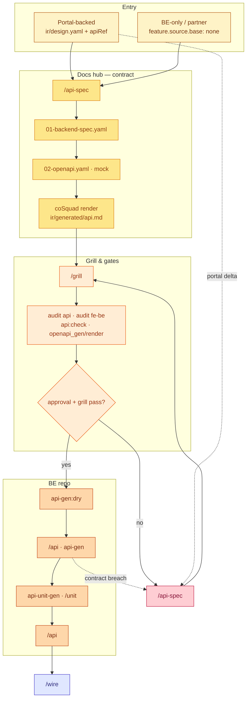
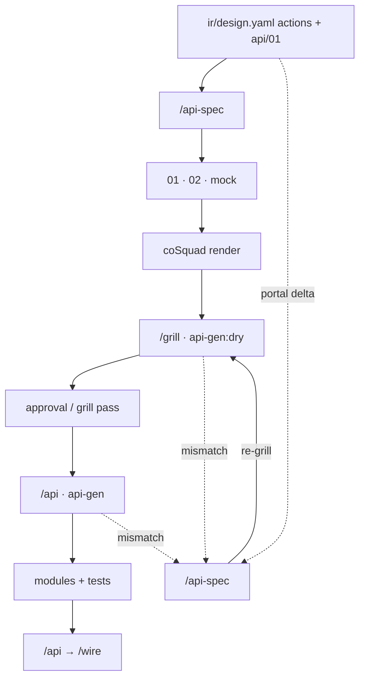
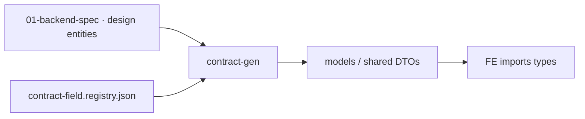

# Workflow — Backend (API & Code)

**Scope (SSOT):** The **Code + Test** lane — specifically the **backend**: leaf contract (`01`), sibling OpenAPI, API grilling, codegen, BE unit tests, and FE–BE alignment prior to wiring.

**Not covered here:** Leaf structure / bundle ↔ IR and multi-repo code artifacts → [artifacts/index.md](../artifacts/index.md) · CLI parameter references → [references/cli-and-commands.md](../references/cli-and-commands.md) · Audit command mappings → [references/audit-commands.md](../references/audit-commands.md).

**Part of Macro Workflows:** [index.md#full-cycle](./index.md#full-cycle) · Phase **2c API** (runs in parallel with 2a FE scaffolding, 2b tests; converges at [wire.md](./wire.md)). Data Model Layer 3: [architecture-data.md](./architecture-data.md) · Design Handoff: [design.md § Handoff](./design.md#handoff-to-downstream-lanes).

---

## API Cycle (Phase 2c) {#api-cycle}

Amber color scheme matches the [Full Cycle](./index.md#full-cycle) workflow. Entry occurs after Design once actions / `apiRef` are clear (or immediately for **BE-only** features).



### Portal ↔ BE Repo (Condensed)



### Sub-lane: Shared Types (`contract-gen`)



`contract:gen`, envelopes, list wiring: [SSOT Artifacts](../artifacts/index.md).

---

## SSOT — Who Reads What {#ssot-reading}

| Role | Reads (Review / Sign-off) | Writes / Implements |
|------|---------------------------|---------------------|
| BA / PO | [VitePress](../artifacts/index.md) `ir/generated/spec.md` + `data-wire.md`; endpoint summary `ir/generated/api.md` | Do not hand-edit `01` — route deltas via `/spec` / Dev |
| BE Dev (Contract) | Site `api.md` first; codegen details: `api/<seq>/01-backend-spec.yaml` | `/api-spec`, `/api-spec`, `/grill` |
| FE Dev (Integration) | `ir/design.yaml` `apiRef`, mock `03` | Do not use `01` for layout inputs — grill-prototype references design |
| Agent BE Codegen | **`01-backend-spec.yaml` only** — never `ir/design.yaml` / `ir/spec.yaml` | `coSquad api-gen` with `--spec` pointing to `01` |

**File Rules:**

- Single function leaf: `api/<seq>/01-backend-spec.yaml` = **one module + one primary entity** (never collapse an entire module into one `01`).
- `coSquad check` validates `*.bundle.yaml` ↔ IR only — **does not** run on `01`.
- After modifying `01`: `api:check` → `openapi_gen` → `openapi_render` → `render` (updates `api.md`).

Unified portal view: `ir/generated/spec.md`, `data-wire.md`, `api.md` (VitePress leaf sidebar). Authoring & OpenAPI toolchain: [tpl-api-contract.md](../../templates/shared/tpl-api-contract.md).

---

## Shared API Architecture & Conflict Prevention (Team Interlock) {#shared-api-architecture}

To systematically resolve **ID contention and Git merge conflicts** when multiple developers work in parallel on screens consuming the same API (e.g., Detail screen `S-01` and Edit screen `S-02` both calling `GET /api/v1/orders/{id}`), CoSquad establishes a two-tiered architectural pattern:

### 1. Top-Down Module API (PM/Leader Pre-Allocation)
- When PM/Leader defines a Module-level Spec (`<module>.module.yaml` via `/module`), the Lead **pre-allocates the shared API roster** detailing primary endpoints.
- These endpoints are centralized from day one to serve as the unified reference contract.

### 2. Centralized Shared API Storage (Contract-First Reference)
- **Decouple API Definitions from Feature Folders**: Shared APIs are not placed haphazardly in feature subdirectories (`<module>/api/`), but centrally maintained in Docs-hub:
  - `surfaces/common/yaml/`: **Global System Common APIs** (`G-API-*`) — File uploads, OTP, Master Data, etc.
  - `surfaces/<surface>/common/yaml/`: **Surface Shared APIs** (`C-API-{SURF}-*`)
  - `surfaces/<surface>/<module>/common/yaml/`: **Module Shared APIs** (`C-API-{SURF}-{MOD}-*`)
- **Contract-First Pre-Design**: BE Lead / Tech Lead models DTO schemas and endpoint contracts in these centralized files **prior** to tasking FE developers.
- **Reference Binding**: In Leaf Specs (`S-*.bundle.yaml` / `feature.bundle.yaml`), FE engineers **only reference via `#reuse-api` + `reuseFrom`** pointing to the shared API. The feature directory contains strictly UI layout specs and private APIs (if any).
- **Zero-Conflict Git Merges**: Because shared API contracts are pre-designed centrally, developers working on parallel screens only link to the file without editing it, guaranteeing **100% conflict-free PR merges**.

---

## Two Entry Modes {#entry-modes}

| Mode | `feature.source` | Grill-API Input | `audit fe-be` |
|------|------------------|-----------------|---------------|
| **Portal-backed** | `base` ≠ `none` | `ir/design.yaml` + `01` | **Required** — `apiRef` ↔ endpoint/entity in `01` |
| **BE-only** | `base: none` (webhook, partner, public API) | **`01` only** — ignores `ir/design.yaml` as contract | None (no portal bundle) |

**Reuse API:** Declare actions/items with `#reuse-api` + `reuseFrom` on design — **do not** duplicate the `01/02/03` trio in the consuming leaf.

Domain hashtags: `#call-external`, `#cross-entity-service` · Codegen hashtags: `#gen:*` (assigned during grilling, executed by codegen scripts). Skill references: harness `/grill`, `/api-spec`.

---

## Preconditions Before Entering Lane {#preconditions}

- **Docs hub in-repo** (or `COSQUAD_DOCS_ROOT`): SSOT `01` resides under `surfaces/…`; never mirror haphazardly into the BE repo as an editable source.
- **Portal-backed:** Design is sufficient to map actions → endpoints; Design rubric item: [design-leaf-signoff.md](./design-leaf-signoff.md) (item 4).
- **BE repo:** Adapter is initialized (`api-gen`, `api-unit-gen` per stack) — paths resolved via config / env ([SSOT § Workspace Code Repositories](../artifacts/index.md#workspace-code-repositories)).
- **New entities / tables:** Phase 0 ERD is updated or team explicitly notes acceptance of omission ([architecture-data.md](./architecture-data.md)).

---

## Router `/api` (Command Selection) {#api-router}

| State | Command |
|-------|---------|
| No `01-backend-spec` yet | `/api-spec` |
| Portal delta / `pendingTechDebt` | `/api-spec` |
| Internal BE modifications only | `/api-spec --be-only` |
| Not codegen-ready | `/grill` |
| Grilling + `approval.status` passed | `/api` → `api-gen` |

**Single session = Single command** — consult `.harness/progress.md` before resuming the same feature slug. Phase transitions (spec → gen → wire) require a new session (per policy in [design.md](./design.md#single-session--single-command)).

### Common Sequences

| Objective | Sequence |
|-----------|----------|
| New feature (portal-backed) | `/api-spec` → `render` → `/grill` → approval → `api-gen:dry` → `api-gen` |
| Portal spec changes | `/api-spec` → re-grill → gates → re-generate impacted layers |
| Incremental pilot | `/api-spec` (list) → grill → code → `/api-spec` (export, etc.) |
| Webhook / partner | `/api-spec` (`base: none`) → `/grill` → `/api` |

### Gap Loop

| Condition | Action |
|-----------|--------|
| `grill-api-spec` or codegen **fails** | `/api-spec` → **re-grill** |
| Portal spec updates mid-flight | `/api-spec` (avoid re-running full `/api-spec` from scratch) |
| `pendingTechDebt` / QA items | Resolve via `/api-spec` or `/qa` on target `01` |

---

## Workflow Steps {#steps}

| Order | Action | Role | Skill / Gate (example) |
|-------|--------|------|------------------------|
| 1 | Inventory endpoints from design / requirements | BE / Fullstack Dev | `/api-spec` → `01` + `02` + mock |
| 2 | Render documentation portal view | Any member | `coSquad render` → `ir/generated/api.md` |
| 3 | Grill contract + codegen hashtags | Dev + Member | `/grill` |
| 4 | Contract quality gates (docs hub) | BE Dev | `audit api`; portal: `audit fe-be`; `api:check`; `openapi_gen`; `openapi_render` |
| 5 | Dry-run codegen | BE Dev | `coSquad api-gen:dry -- --spec …/01` |
| 6 | Generate, implement & unit test | BE Dev | `/api`, `api-unit-gen`, `/unit`, `/grill` |
| 7 | Pre-wire audit | BE Dev | `/api` · re-run `audit fe-be` if portal changed |

Milestones in leaf closure: [gates.md § Contract BE](./gates.md#close-one-function) (milestone 5).

### Technical Deliverables of `/api-spec`

- `api/<seq>/01-backend-spec.yaml` — SSOT BE contract (modules, entities, endpoints, errors, `codegen.profile`).
- Sibling `02-openapi.yaml` (generated; never edit manually — patch `01` and re-generate).
- `03-mock.yaml` (per stack / prototype policy).
- Portal-backed: Maintain `apiRef` in `ir/design.yaml` matching paths/methods in `01`.

### Grilling in Backend

- **Reuse & matrix:** `#reuse-api`, HTTP/error matrices (409, 422, 403), optimistic locking, permissions.
- **BE-only:** Auth scheme, idempotency, retries, partner error catalogs (`#err:signature-invalid`, etc.).
- **Readiness:** `approval.status`, `codegen.profile|entity|module`, `endpoints[].action`, `#gen:*` — missing prerequisites → STOP, do not run `api-gen`.

Grill vs audit comparisons: [grill-and-human-review.md](./grill-and-human-review.md). Audit does **not** replace human sign-off on `confirms[]`.

---

## API Contract Sign-off (Voluntary per Team) {#api-signoff}

Voluntary — not an engine lock on Design grill order. Recommended prior to production `api-gen`:

| # | Item | Verification |
|---|------|--------------|
| 1 | **Structural** | `coSquad audit api` — `gaps[]` resolved or deliberately routed to `#tech-debt:Q-*` (legacy `QA-*`) |
| 2 | **FE–BE** (portal) | `coSquad audit fe-be` — `apiRef` ↔ `01` has no blockers |
| 3 | **Toolchain** | `api:check`, `openapi_gen`, `openapi_render` exit 0 |
| 4 | **Readability** | VitePress `api.md` + (if needed) `02` preview — BA understands endpoint scope |
| 5 | **Approval** | `approval.status: approved` on `01` per team policy |
| 6 | **QA** | No hidden `openQuestions` on `01`; tech debt in `qa` is accepted |

Sign-off entry (PR / progress):

```text
API sign-off: <page-id or API-id> | seq: <api/01> | reviewer: <name> | date: YYYY-MM-DD
```

---

## Handoff {#handoff}

- **Wire:** Following API grill + unit test coverage → [wire.md](./wire.md) (`/wire`, post-wire E2E).
- **Test:** [test.md](./test.md) runs in parallel once `TC-*` exists — partner/webhook: Newman / BE integration or Playwright `request` ([§ API hook](./test.md#integration-api-hooks)).
- **Design updates:** UX changes affecting contracts → `/api-spec` or `/spec` + split; do not patch BE repositories in isolation.
- **FE scaffold:** Phase 2a can proceed before wire; type contracts imported via `contract-gen` when enabled.

---

## Quick Links

| Topic | Page |
|-------|------|
| Closing a leaf `W-*` (Milestone 5 BE) | [gates.md](./gates.md#close-one-function) |
| Design sign-off (API criteria) | [design-leaf-signoff.md](./design-leaf-signoff.md) |
| OpenAPI skill | [references/skills/api-spec.md](../references/skills/api-spec.md) |
| Grill API | [references/skills/grill.md](../references/skills/grill.md) |
